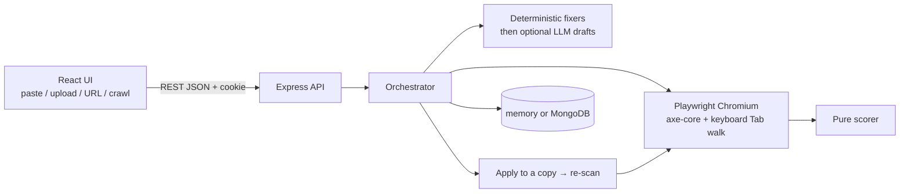

# AccessFix

Paste HTML, get WCAG 2.2 AA issues in plain language, apply **real source fixes** in an isolated
preview, and see a **verified** before/after score. Fix-first, no overlays, works with the LLM off.

Hackathon problem statement PS 11: "Web Accessibility Auditor + Fix-Suggester".

> **Status: Phase B.** Paste HTML or a URL, or crawl one host (signed in). Verified source fixes,
> optional AI drafts, accounts, private scans, share links, and the results workbench. Quotas are
> off unless `QUOTAS_ENABLED=true`. Memory store by default; Mongo when you set `STORE=mongo`.
> The full map is [`project.md`](project.md). Crawl and auth limits are in
> [`docs/12-phase-b.md`](docs/12-phase-b.md).

## Quick start

Requirements: Node 20.11+ (see `.nvmrc`), npm 10+.

```bash
npm install                 # installs backend + frontend (npm workspaces)
cp .env.example .env        # optional; every value has a safe default
npm run browsers:install    # Chromium for Playwright (~150 MB, once)
npm run dev                 # API on :4000, web on :5173
```

Open http://localhost:5173. The header should say **"API online"**. Click **Try the broken
sample** to scan `samples/broken-sample.html` (about 1.5 s). Then **Suggest fixes** and
**Apply verified fixes** — the score should rise, with placeholders (like image alt text)
left for you to fill in.

To scan a local site (for example the AccessFix UI itself), start the API with
`ALLOW_PRIVATE_URLS=true` in `.env`. That is dev-only: the server refuses it in production and
the UI shows a warning badge while it is on.

## Scripts (run from the repo root)

| Script                            | What it does                                                                 |
| --------------------------------- | ---------------------------------------------------------------------------- |
| `npm run dev`                     | API (node --watch) and web (Vite) together                                   |
| `npm test`                        | Vitest in both workspaces (browser tests skip loudly if Chromium is missing) |
| `npm run test:browser -w backend` | Only the real-Chromium suites                                                |
| `npm run test:unit -w backend`    | Only the fast backend unit tests                                             |
| `npm run lint`                    | ESLint 9 (flat config, `jsx-a11y` strict on the frontend)                    |
| `npm run format` / `format:check` | Prettier                                                                     |
| `npm run build`                   | Production build of the frontend                                             |
| `npm run browsers:install`        | Download Playwright Chromium                                                 |

## How a scan works



1. **Input.** Paste HTML, upload an `.html` file plus `.css` files (the browser inlines the CSS, then the 5 MB cap applies), or scan a public URL. Signed-in accounts can crawl one host (breadth-first, robots.txt, default 10 pages / depth 2 while quotas are off).
2. **Render.** Isolated Chromium. Public stylesheets and images load; private addresses are blocked. A Tab walk (up to 50 stops) is recorded as hints, not axe violations.
3. **Check.** axe-core WCAG 2.2 A/AA plus our heading/keyboard checks. Results include failed rules, passed rules (for the Checks table), and “check by hand” items. Color-contrast evidence is stored only when both colors were measured.
4. **Explain.** Each issue card says what is broken, who it affects, why it matters, and how we fix it. Marks on the screenshot stay in reading order.
5. **Repair.** Suggest fixes runs deterministic patches first. The LLM, if on, only drafts wording. Nothing is applied until you accept drafts and click Apply verified fixes.
6. **Verify.** The patched copy is re-scanned. A fix is verified only if that issue is gone and nothing else broke. Then you can copy or download the patched HTML, or a ZIP of original + patched pages (up to 20 MB).

The score is automated checks only. It is not a WCAG conformance claim.

## Accounts, plans and quotas

Auth is real: `POST /signup` (201) and `POST /login` (200) set an HttpOnly `accessfix.sid` cookie. Mutating calls send `x-accessfix-request: 1`. There is no password reset.

| | Signed out | Free | Pro |
| --- | --- | --- | --- |
| Scans / UTC day | 100 | 30 | 300 |
| Pages / day | — | 100 | 1,000 |
| AI tokens / day | — | 50,000 | 300,000 |
| Pages / crawl | — | 5 when quotas on, else `CRAWL_MAX_PAGES` (10) | 10 when quotas on, else 10 |

Quotas are **off** unless `QUOTAS_ENABLED=true`. Commands (also listed on `/business`):

```bash
# .env — turn limits on
QUOTAS_ENABLED=true

# .env — these emails become Pro on the next sign-in (works with the memory store)
PRO_EMAILS=owner@example.com

# Mongo only — change an existing account
npm run plan:pro -- user@example.com pro
npm run plan:pro -- user@example.com free
```

## Persistence and the LLM

```bash
# Mongo (optional). Default STORE=memory is wiped when the API restarts.
docker compose up -d mongo
# .env
STORE=mongo
MONGODB_URI=mongodb://127.0.0.1:27017/accessfix

# LLM (optional). Off = rule-based fixes still work.
LLM_PROVIDER=openai-compatible
LLM_API_KEY=...
LLM_MODEL_CHEAP=...
```

Leave `REDIS_URL` empty. Leave `QUOTAS_ENABLED` false unless you want the table above enforced. `ALLOW_PRIVATE_URLS=true` is dev-only (the API refuses it in production).

## Layout

```
.
├── docs/                      product, business, architecture, contracts (read first)
├── backend/
│   ├── src/
│   │   ├── app.js             createApp(config, overrides): DI root, middleware, routes
│   │   ├── server.js          process entry
│   │   ├── config/env.js      Zod-validated config, safe defaults
│   │   ├── routes/            route table mirroring docs/04-api-contract.md
│   │   ├── controllers/       thin HTTP adapters -> orchestrator
│   │   ├── middleware/        validate (Zod), rate limit, timeout, error envelope
│   │   ├── schemas/           Zod contracts: Violation, Repair, VerificationResult, Score, TokenUsage, Scan
│   │   ├── services/
│   │   │   ├── orchestrator/  sequences scan -> repair -> verify
│   │   │   ├── scanner/       Playwright + axe-core (+ checks/ for our own rules)
│   │   │   ├── repair/        repair engine (+ rules/ one fixer per axe rule)
│   │   │   ├── verifier/      apply to copy, re-scan, diff
│   │   │   ├── scorer/        pure score function
│   │   │   └── llm/           provider interface (none | openai-compatible | mock)
│   │   ├── repositories/      ScanRepository contract, memory + Mongo adapters
│   │   └── utils/             errors, logger
│   └── tests/                 Vitest + Supertest (fixtures/ for rule HTML)
└── frontend/
    ├── components.json        shadcn/ui config (JavaScript)
    └── src/
        ├── App.jsx            shell: skip link, header, main
        ├── components/        ApiStatus (+ shadcn ui/ as added)
        ├── lib/               api client, contrast math, cn()
        └── styles/tokens.js   design tokens (source of truth, contrast-tested)
```

## Principles (short version)

1. Every issue ends in a patch or an honest "needs manual review".
2. We change source markup and CSS; we never inject runtime widgets.
3. Deterministic fixes first; the LLM only drafts words.
4. Token cost is tracked, budgeted and shown.
5. Detection comes only from axe-core and our own deterministic checks.
6. A fix is "verified" only after a re-scan shows the violation gone and nothing regressed.
7. The product works with the LLM turned off.

The score covers automated checks only. It is not a WCAG conformance claim. See
[docs/06-scoring-spec.md](docs/06-scoring-spec.md).

See [docs/03-architecture.md](docs/03-architecture.md), [docs/10-deploy.md](docs/10-deploy.md), [docs/11-demo-script.md](docs/11-demo-script.md), and [docs/12-phase-b.md](docs/12-phase-b.md).
