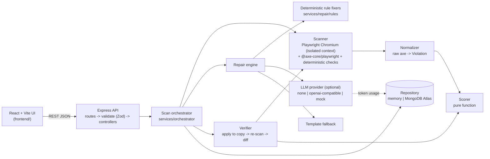

# 03. Architecture

## System diagram



## Module boundaries

| Module        | Path                                      | Owns                                                                       | Must not                       |
| ------------- | ----------------------------------------- | -------------------------------------------------------------------------- | ------------------------------ |
| Routes        | `backend/src/routes`                      | URL -> middleware -> controller table                                      | Contain logic                  |
| Middleware    | `backend/src/middleware`                  | Zod validation, rate limiting, timeouts, error envelope                    | Know about scans               |
| Controllers   | `backend/src/controllers`                 | Translate HTTP <-> orchestrator calls                                      | Call services directly         |
| Orchestrator  | `services/orchestrator`                   | Sequencing of scan / repair / verify; status transitions; usage recording  | Talk HTTP; touch Playwright    |
| Scanner       | `services/scanner`                        | Browser pool, isolated contexts, axe run, our extra checks                 | Normalize, score, or fix       |
| Normalizer    | `services/scanner/normalize.js` (Phase 1) | axe result -> `Violation` (plain language, WCAG criteria, signature)       | Call the LLM                   |
| Scorer        | `services/scorer`                         | Pure `computeScore(raw)`                                                   | Do I/O                         |
| Repair engine | `services/repair`                         | Strategy order, per-rule fixers, patch + diff generation                   | Detect violations              |
| LLM           | `services/llm`                            | Provider adapters, batching, cache, budget, rate limiting, circuit breaker | Detect violations; be required |
| Verifier      | `services/verifier`                       | Apply patches to a copy, re-scan, per-repair outcome, regressions          | Mutate the original input      |
| Repositories  | `backend/src/repositories`                | Persistence behind `ScanRepository`                                        | Leak driver types upward       |
| Utils         | `backend/src/utils`                       | Errors, logger, hashing                                                    | Depend on services             |

Rule: **controllers -> orchestrator -> services -> repositories**. Services never import each other
except through the orchestrator. The exceptions are the verifier, which receives the scanner and
scorer as injected dependencies, and the repair engine, which receives the LLM provider. Every
dependency is injected through `createApp(config, overrides)` so tests can replace it.

## Data flow

### 1. Scan (`POST /scans`)

1. Zod validates the body; HTML larger than `MAX_HTML_BYTES` is rejected with 413.
2. The orchestrator creates the scan record (`scanning`).
3. Scanner:
   - Parse the HTML once server-side and tag every element with `data-afx-id="n"`. This stable
     handle lets patches and before/after diffs survive selector changes. It is stripped from all
     output.
   - New browser context per scan (no shared cookies or storage). Network requests are aborted
     except `data:` URLs, so pasted HTML cannot reach the internet or internal hosts.
   - `page.setContent(html)`, wait for `load` (bounded), run axe with tags for WCAG 2.2 AA
     (+ `best-practice`, + AAA if opted in), then run our deterministic checks.
   - For each result node, read its `data-afx-id`.
4. Normalizer: violations -> `violations[]` (category `wcag`) or `advisory[]` (`best-practice`);
   incomplete -> `manualReview[]`. Each gets plain-language text from the catalog, WCAG
   criteria from axe tags, and a `signature`.
5. Scorer -> `Score`. Store. Respond `201` with the full `Scan`.

Pasted-HTML scans are **synchronous**: they finish in a few seconds, which keeps Phase 1 simple.
The `status` field already exists, so URL scans can become asynchronous later (`202` + poll)
without changing the contract.

### 2. Repairs (`POST /scans/:id/repairs`)

For each selected open violation, in this order:

1. **Deterministic fixer** for the rule (doc 05). If it returns a patch: `strategy: deterministic`.
2. Else, if the rule needs judgment and the LLM is enabled and within budget: group by
   `signature`, batch, call the LLM once per unique signature, and fan the result back out.
   `strategy: llm`, `needsHumanInput: true` for content such as alt text.
3. Else **template**: a safe structural patch with a clearly marked placeholder (e.g.
   `alt="TODO: describe the image"`). `strategy: template`, `needsHumanInput: true`.
4. Else **manual**: `patch: null` with a specific "how to check" note. `status: manual-review`.

Every violation leaves step 4 with exactly one Repair. That is the fix-first guarantee.

### 3. Verify (`POST /scans/:id/verify`)

1. Load the original tagged HTML; apply the selected patches by `data-afx-id` to a **copy**.
2. Re-scan the copy with identical options and axe version.
3. Diff by `(ruleId, afxId)`:
   - target violation gone -> `resolved`;
   - still present -> `still-failing`;
   - any violation in the after-scan that was not in the before-scan -> `regressions[]`, and every
     repair touching that element is marked `regressed`.
4. A repair is `verified` only if it is `resolved` and there are no regressions on elements it touched.
5. Return `VerificationResult` with before and after `Score` and the patched HTML (afx ids stripped).

## Error model

All errors use one envelope:

```json
{
  "error": {
    "code": "SCAN_TIMEOUT",
    "message": "Request exceeded 30000 ms.",
    "details": null,
    "requestId": "a1b2c3d4e5"
  }
}
```

| Code                  | HTTP | When                                                        | Client behaviour                              |
| --------------------- | ---- | ----------------------------------------------------------- | --------------------------------------------- |
| `VALIDATION_ERROR`    | 400  | Zod failure or bad JSON; `details[]` has `path` + `message` | Show inline field errors                      |
| `NOT_FOUND`           | 404  | Unknown scan / route                                        | "Scan expired or not found"                   |
| `PAYLOAD_TOO_LARGE`   | 413  | HTML over limit                                             | Show the limit                                |
| `UNSUPPORTED_INPUT`   | 422  | e.g. URL scans before Phase 2, non-HTML content             | Explain and offer paste                       |
| `RATE_LIMITED`        | 429  | Per-IP request limit; `RateLimit` headers set               | Countdown, retry                              |
| `INTERNAL`            | 500  | Unexpected; logged with `requestId`                         | Generic message + requestId                   |
| `NOT_IMPLEMENTED`     | 501  | Contracted but not built yet                                | Phase notice                                  |
| `BROWSER_UNAVAILABLE` | 503  | Chromium missing or crashed                                 | "Scanner offline"; `/health` shows `degraded` |
| `SCAN_TIMEOUT`        | 504  | Render or axe exceeded `SCAN_TIMEOUT_MS`                    | Suggest a smaller input                       |

**LLM problems are never request errors.** Over budget, rate-limited, open circuit or a bad JSON
reply all degrade to the template strategy. The repair carries the reason, and `/health` reports
`llm: circuit-open` when the circuit breaker has tripped.

## Security and isolation

- Each scan uses a fresh Playwright browser context; the browser process is shared and contexts
  are capped by `BROWSER_MAX_CONTEXTS`.
- Pasted HTML: all outbound network requests are blocked.
- Helmet, CORS allow-list, JSON body cap, per-IP rate limit, request timeout.
- No secrets in logs (`authorization` and `cookie` are redacted). LLM prompts get size-capped,
  attribute-filtered snippets, never the whole page (doc 07).

## Where each future challenge plugs in

| Challenge                   | Plug-in point                                                                                  | Contract impact                                  |
| --------------------------- | ---------------------------------------------------------------------------------------------- | ------------------------------------------------ |
| URL input (Phase 2)         | `scanner` input adapter + `utils/safeFetch` (DNS resolve, block private ranges, redirect cap)  | None; `ScanInput` already has `url`              |
| SPA hydration               | Scanner "ready" strategy: network idle + DOM mutation quiet period + optional selector         | `ScanOptions.waitFor` (additive)                 |
| Auth-gated pages            | Per-scan `storageState` / cookies injected into the isolated context                           | `ScanOptions.auth` (additive, encrypted at rest) |
| Keyboard / focus simulation | New `scanner/checks/focus-*.js` emitting axe-shaped results                                    | New rule IDs, source `accessfix`                 |
| ARIA widget semantics       | Same as above, per widget pattern                                                              | New rule IDs                                     |
| Multi-page crawl            | New `crawler` service feeding the orchestrator a URL list; a scan becomes a `Site` of `Scan`s  | New `/sites` resource                            |
| Source-code mapping         | Post-processor mapping `data-afx-id` to source positions via source maps / framework dev hooks | `Patch.sourceLocation` (additive)                |
| CI action                   | Thin client over the public API + a `--fail-under` score threshold                             | None                                             |
| Multi-language              | Message catalog keyed by rule ID and locale; axe locales                                       | `Accept-Language`                                |
| MongoDB                     | `repositories/mongoScanRepository.js` passing the shared contract tests                        | None                                             |

See [09-roadmap-future.md](09-roadmap-future.md) for the pathway behind each row.
