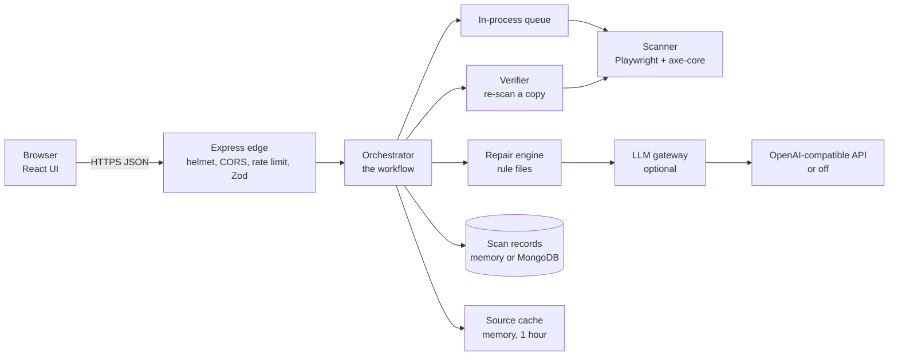
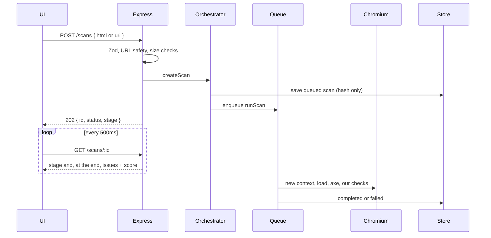

# AccessFix — how the system works

This file explains the running system in plain technical English: what each part is, why we chose
it, how a request moves through it, and what is still only a plan. The short specs in
[`docs/`](docs/README.md) stay the source of truth for the score formula and the exact JSON
shapes. When this file and the code disagree, the code wins.

Hackathon problem statement PS 11: Web Accessibility Auditor + Fix-Suggester.

## 1. What the product does

You paste HTML or give one public URL. AccessFix opens that page in a headless browser, runs
accessibility checks, explains the failures, and proposes edits to the HTML and CSS. You accept
the edits. AccessFix applies them to a **copy**, runs the checks again, and marks a fix
**verified** only if that problem is gone and nothing new broke. You get a before/after score,
the patched file, and a link you can share.

It does not inject a widget into the site. It does not claim the page is fully WCAG compliant.
A score of 100 means “no automated failures on this page.”

## 2. The shape of the system

There are two programs.

| Program | What it is | Where it runs |
| --- | --- | --- |
| Web UI | A React app built by Vite into static files | Browser. Dev server on port 5173. In production, any static host. |
| API | One Node process: HTTP server + job runner + Chromium | Port 4000. In production, a Docker container that already contains Chromium. |

The browser never talks to Chromium or to MongoDB. It only talks to the API over HTTP with JSON.



### There is no separate API gateway product

We did not put Kong, NGINX, or a cloud API Gateway in front of the app. For this product that
would be an extra moving part, and it still could not run the browser. Chromium has to live in
the same process that starts the scan, because the scan holds a browser context until axe
finishes.

The **edge** is Express middleware in `backend/src/app.js`. That is the only public door. In
order, every request passes through:

| Step | Library | Why it is there |
| --- | --- | --- |
| Security headers | `helmet` | Sets safe default HTTP headers so the API is not a casual XSS or clickjacking target. |
| CORS | `cors` | The UI is on a different origin (5173 vs 4000, or a static host vs the API). The browser blocks that unless we allow `CORS_ORIGINS`. |
| Request id + logs | `pino` and `pino-http` | Every line can be tied to one request. `authorization` and `cookie` are not logged. Polling `GET /scans/:id` is not logged, or the log would be nothing but polls. |
| Global rate limit | `express-rate-limit` | `RATE_LIMIT_RPM` (default 300/min per IP) stops one client from flooding every route, including polls. |
| Request timeout | our `requestTimeout` | If the handler has not answered in `REQUEST_TIMEOUT_MS` (60s), the client gets `SCAN_TIMEOUT` instead of hanging. |
| JSON body | `express.json` | Parses the body, and refuses bodies bigger than the HTML limit plus a small overhead. |
| Route + Zod | `zod` in `middleware/validate.js` | Bad input fails here with `400` and a field path, before any browser starts. |
| Scan rate limit | second `express-rate-limit` | `SCAN_RATE_LIMIT_RPM` (default 10/min) on `POST /scans`, `POST /repairs`, and `POST /verify`. Polling is cheaper and is not under this cap. |
| Controller | thin functions | Read the validated input, call the orchestrator, write JSON. No business rules. |
| Error handler | `middleware/errorHandler.js` | Every failure becomes `{ error: { code, message, details, requestId } }`. Unexpected errors become `INTERNAL` with no stack in the response. |

A second “gateway” **does** exist, but only for the language model: `createLlmGateway` in
`backend/src/services/llm/index.js`. The repair engine never calls OpenAI directly. It calls
this gateway, which caches, batches, budgets, rate-limits, and rejects unsafe drafts. If the
gateway is off (`LLM_PROVIDER=none`), repairs still work.

### Why the pieces are split this way

The rule in the code is **HTTP → orchestrator → services → store**. Controllers do not open
Playwright. The scanner does not write patches. The scorer does not do I/O. Tests replace the
scanner, the store, or the model by passing overrides into `createApp()`. That is why a fast
unit test can run the whole API with a fake browser.

## 3. What we use, and why

### Runtime and repo

| Choice | Why |
| --- | --- |
| Node 20.11+ (`.nvmrc` is 20) | Current LTS line, native `fetch`, ESM. |
| npm workspaces | `backend` and `frontend` install together. One `npm run dev` starts both. |
| ES modules (`"type": "module"`) | Matches the Node and Vite defaults. No compile step on the API. |
| `concurrently` | Runs the API watcher and Vite in one terminal. |

### API

| Choice | Why |
| --- | --- |
| Express 5 | Small, well known, enough for a JSON API. We do not need a second framework. |
| Zod | One schema describes a request and a response. The same schemas are what `docs/04` mirrors. Invalid input fails before a scan starts. |
| nanoid | Scan ids are `s_` plus 21 URL-safe characters. They are capability links: knowing the id is the permission. Short sequential ids would be guessable on a shared server. |
| Pino | Structured JSON logs with a `scanId` on scan work. |

### Browser and detection

| Choice | Why |
| --- | --- |
| Playwright + Chromium | Accessibility depends on the rendered page: computed colours, layout, the DOM after scripts. A regex over the HTML string cannot see that. Playwright gives us a real browser, a context we can throw away, and request interception. |
| `@axe-core/playwright` and `axe-core` 4.14 | axe is the industry checker for WCAG issues a machine can see. We did not write our own contrast or label engine for the long tail of rules. We tag `wcag2a`, `wcag2aa`, `wcag21a`, `wcag21aa`, `wcag22aa`, plus `best-practice`. AAA tags are added only when asked. |
| Our own checks (`scanner/checks/`) | Two things axe does not give us in the shape we need: a heading outline (including shadow DOM) and “read more” links that do not say where they go. They return axe-shaped results so the rest of the pipeline does not care who found them. |
| Not Lighthouse | Lighthouse’s accessibility score is a weighted pass/fail of audits. Fixing 9 of 10 buttons does not move that audit. We want a score that moves per element. We still use the same impact weights Lighthouse documents (10, 7, 3, 1). We do not shell out to Lighthouse. |
| Not Puppeteer | Playwright’s API matched the pool, the network guard, and the axe package we already depend on. One browser automation library is enough. |

### Safety around the browser

| Choice | Why |
| --- | --- |
| One Chromium process, a new context per scan (`browserPool.js`) | Starting a browser per scan is slow. Sharing one process is cheap. A fresh context means cookies, storage, and service workers from scan A cannot leak into scan B. |
| Caps `BROWSER_MAX_CONTEXTS` (4) and `SCAN_QUEUE_MAX` (20) | Chromium will exhaust RAM if every visitor opens a page at once. Past the queue the API returns `SCANNER_BUSY`. |
| `SCAN_TIMEOUT_MS` (30s) closes the context | A page with `while(true){}` must not hold a slot forever. |
| `urlSafety.js` + `pinnedFetch.js` | A URL scan must not be a way to hit `localhost`, cloud metadata, or a private network (SSRF). We resolve DNS, reject private and metadata ranges, and connect to the IP we already checked so a rebinding attack cannot swap the address after the check. |
| Network guard | Every image, stylesheet, and script the page requests is checked again. WebSockets are closed. WebRTC is restricted so the page cannot probe the local network. Over-size or too many subrequests are blocked and counted in `network.blocked`. |
| `ALLOW_PRIVATE_URLS` | Dev only, so we can scan the AccessFix UI on localhost. Production refuses to boot if this is true. |

### Repairs

| Choice | Why |
| --- | --- |
| Cheerio + our own edit list (`repair/edits.js`) | We need to change the original source text and show a diff, not a second DOM that no longer matches the file. Cheerio finds the node. Edits are offset-based so the patch is a real unified diff (`diff` package). |
| One file per rule family in `services/repair/rules/` | A new fix is a new file plus a fixture test. Rules with no file become “needs a person” instead of a guessed patch. |
| `TODO:` placeholder | If we do not know the words (alt text, a button name), we still change the structure, but we refuse to apply the patch until a human replaces `TODO:`. |
| Verifier re-scan | A diff that looks right can still break another rule. The verifier runs axe again on the copy. |
| Source cache, 1 hour, memory only (`sourceCache.js`) | Repairs need the original HTML. We do not put that HTML in MongoDB: it can contain customer content, and the database is not where we want it. After an hour, or after a restart, Suggest fixes returns `SOURCE_EXPIRED`. The scan **record** (issues, score, no raw HTML) can still be read. |

### Model

| Choice | Why |
| --- | --- |
| Optional, default off | Most common fixes (contrast, `lang`, labels, heading level) do not need a model. The demo must work with no API key. |
| One OpenAI-compatible client | OpenAI, Groq, OpenRouter, Gemini’s compatible endpoint, and Ollama all speak the same chat API. We did not write a client per vendor. |
| Three model slots | `LLM_MODEL_CHEAP` for names and labels, `LLM_MODEL_VISION` for alt text from an image already captured during the scan, `LLM_MODEL_STRONG` for one retry when the cheap answer is bad JSON or low confidence. |
| Gateway in front of the model | Cache, batching (up to 10 items), per-scan token budget (8,000), per-IP daily budget (100,000, in memory), RPM/TPM token buckets, a circuit breaker, and a check that the draft is plain words (no HTML, no URLs). A failure here becomes a template. It is never an HTTP 500. |
| `<untrusted>` wrapping | Page snippets are data, not instructions. The safety check also rejects drafts that contain tags. |

### Store and jobs

| Choice | Why |
| --- | --- |
| `ScanRepository` interface | The rest of the app calls `saveScan`, `getScan`, `listByIds`, repairs, verifications, usage. It does not import the Mongo driver. |
| In-memory adapter by default | `npm run dev` and `npm test` need no database. Least-recently-used eviction at `STORE_MAX_SCANS` (200). |
| MongoDB driver 6, not Mongoose | We store a few document shapes and need TTL indexes. An ODM would hide that and add a layer we do not use. |
| TTL on `_expireAt`, default 30 days | Shared links should die. An Atlas free cluster should not fill up. The index is on scans, repairs, verifications, and usage. |
| `STORE=mongo` with an empty URI fails at startup | A silent fallback to memory would look like production persistence and then lose data. |
| In-process queue (`services/jobs/inProcess.js`), not Redis or BullMQ | One Node process is the whole API. A second queue server is documented as a later swap (same `enqueue` / `idle` shape) and is not required for the demo. |
| Retry once, only on unexpected crashes | A timeout or a 429 must not launch Chromium a second time for the same bad page. Typed errors (`AppError`) are not retried. |

### UI

| Choice | Why |
| --- | --- |
| React 19 + Vite | The UI is a client of the API. Vite builds static files. We did not use Next.js: the API cannot be a serverless function (it holds Chromium), so a separate static UI is simpler to host. |
| Tailwind 4 | Utility classes, no custom CSS framework to maintain. Tokens live in `styles/tokens.js` and `index.css`, and a test checks they match and meet contrast. |
| shadcn/ui, JavaScript (`components.json` has `tsx: false`) | Accessible button, tabs, badge, and alert primitives without adopting TypeScript for this repo. |
| No web fonts | The system UI font and a monospace stack. Nothing extra to download, and the self-scan cannot fail on a font request. |
| No react-router | Four routes. `lib/path.js` listens to the History API. `Link.jsx` is a normal `<a>` that does an in-app navigation on a left click, and still works with open-in-new-tab. |
| Recharts | The history page draws score over time. A data table under the chart carries the same numbers, because a chart alone is not accessible. |
| `localStorage` key `accessfix.history.v1` | There are no accounts. The browser remembers scan ids it created. The server will not list “everyone’s scans.” |
| jsdom + Testing Library + Vitest | UI tests without a browser. Real Chromium tests live in the backend and scan the built UI. |
| ESLint 9 + `eslint-plugin-jsx-a11y` | The product’s own UI has to pass the kind of checks it sells. |

## 4. Workflows

### 4.1 Scan



What happens before the 202, so bad input never occupies Chromium:

1. Zod checks the body. Empty HTML, non-http URLs, and broken JSON are `400` or `422`.
2. HTML larger than 500 KB is `413`. Binary-looking input (too many control characters) is `422`. NUL bytes are stripped.
3. For a URL, DNS is resolved and private addresses are `URL_BLOCKED`.
4. An optional `Idempotency-Key` header (max 128 characters, remembered 24 hours in memory) returns the same scan id if you retry the same POST.
5. The record stores a SHA-256 of the input, not the HTML. The raw HTML goes only into the one-hour source cache after the scan succeeds.

Stages the UI shows: queued → loading → rendering (wait until the network is quiet, at most 5 seconds; `page.settled` is false if it never is) → checking → normalizing → done. A failure stores a code such as `SCAN_TIMEOUT`, `FETCH_FAILED`, `BROWSER_UNAVAILABLE`, or `INTERNAL`.

During checking, each element gets a runtime id in a `WeakMap` inside the page. It is not written into the HTML as an attribute, so axe snippets stay clean. That id is how a later re-scan knows “this is the same button.”

The normalizer then sorts axe output:

| Bucket | Comes from | In the score? |
| --- | --- | --- |
| `violations` | axe WCAG failures | Yes |
| `manualReview` | axe `incomplete` (it could not decide) | No, always listed |
| `advisory` | axe best-practice, plus our heading and link checks when they do not duplicate axe | No, still fixable |

Plain-language titles (“Image has no text alternative”) come from `scanner/templates/`, not from the model. Each item links to the W3C Understanding page for its criterion.

### 4.2 Suggest fixes

`POST /scans/:id/repairs` with `{ useLlm: true|false }`.

Preconditions: the scan is `completed`, and the source cache still has the HTML. Otherwise `409 SCAN_NOT_READY` or `410 SOURCE_EXPIRED`.

For each violation and advisory item, in this order:

1. **Rule fixer**, if `services/repair/rules/` has that rule id. The result is a small edit (attribute, tag, CSS colour, `lang`, `title`) plus a unified diff.
2. **LLM gateway**, only if the rule needs words, `useLlm` is true, and a provider is configured. Identical patterns are one call. The draft is stored on the repair and is **not** applied until you accept it.
3. **Template** with `TODO:` in the text. Status `needs-input`.
4. **Manual**. `patch` is null. Status `manual-review`. This is also the path when no fixer file exists.

Automatic proposals (not templates, not unaccepted drafts) are re-scanned immediately, offline, using the responses captured during the first scan so verification does not hit the network again. The card can already say Verified before you press Apply.

Fixer files that exist today:

| File | Rules | What it changes |
| --- | --- | --- |
| `colorContrast.js` | `color-contrast` | Moves the text colour, same hue, until the contrast ratio clears. Edits the stylesheet rule when one rule owns that colour, otherwise an inline style. |
| `documentLang.js` | `html-has-lang`, `html-lang-valid` | Adds or corrects `lang` on `<html>`. |
| `documentTitle.js` | `document-title` | Fills `<title>` from the first `h1`, or leaves a template. |
| `formLabel.js` | `label`, `select-name` | Wraps nearby text in `<label for>`, or inserts a label from the field name. Not `aria-label`. |
| `accessibleName.js` | `button-name`, `link-name`, `input-button-name` | Names a control from its title, a known icon word (`cart`, `menu`, `search`), or the URL path. |
| `imageAlt.js` | `image-alt`, `input-image-alt` | Empty alt when the image is decorative; otherwise a template or a model draft. |
| `headingLevels.js` | heading order and our heading checks | Changes `h3` to `h2` (and so on) and adds a class so the visual size stays. |
| `linkContext.js` | ambiguous link text | Adds hidden context so “Read more” says read more about what. |
| `duplicateId.js` | duplicate id rules | Renames later duplicates. |
| `simpleAttributes.js` | `meta-viewport`, `tabindex` | Removes zoom-blocking viewport settings; sets positive `tabindex` to `0`. |

[`docs/05-repair-catalog.md`](docs/05-repair-catalog.md) lists more rules (lists, many ARIA attributes, target size, landmarks). Those rows are the intended catalog. Until a file exists, the issue is explained and left for a person.

### 4.3 Apply and re-scan

`POST /scans/:id/verify` with the repair ids you chose, plus any filled-in placeholder text and the ids of AI drafts you accepted.

The verifier:

1. Copies the cached source.
2. Applies only the allowed edits. A leftover `TODO:` is `not-applied`. An AI draft you did not accept is `not-applied`.
3. Runs the scanner again on that copy (replay from the captured resources when it can).
4. Compares by rule id and element id.
5. Returns before score, after score, resolved, remaining, regressions, and the patched HTML.

A repair is verified only when its issue is gone and it did not create a new issue on an element it touched. The UI then shows `49 → 98` (or whatever the numbers are), a download of `patched.html`, and a sandboxed preview.

`GET /scans/:id/patched.html` is the same HTML as a file download.

### 4.4 Report

`GET /scans/:id/report?format=json|md|html`.

JSON is the report object. Markdown and HTML are file downloads (`Content-Disposition: attachment`). HTML has no `<script>`. Every snippet from the page is escaped. The response sets a Content-Security-Policy of `default-src 'none'` (inline styles only, because the report is a document, not an app). A test feeds `<script>` and `onerror=` and checks they cannot run.

The UI route `/scans/:id/report` is our app, not that file. It fetches the JSON and offers the three downloads. Next to the link: anyone who has it can view it, and it expires in about 30 days.

### 4.5 History

1. When a scan finishes or fails, `useScan` writes `{ id, createdAt, score, label }` into `localStorage` (last 50).
2. `/history` reads those ids and calls `GET /scans?ids=...`.
3. Unknown or expired ids are omitted. There is no route that returns every scan in the database. That would leak other people’s work on a shared MongoDB.
4. If at least two scans have a score, Recharts draws a line and a table lists the same scores.

### 4.6 Health

`GET /health` is what the header badge uses. `browser: up` means Chromium launched. `store` is `memory` or `mongo`. `llm` is `off`, `on`, or `circuit-open`. If the browser is down, the Scan button is disabled and the reason is on screen.

## 5. Score and WCAG

Standard in force: **WCAG 2.2 Level A and AA**. AAA is off unless the request sets `includeAAA`.

```
score = round(100 × (1 − Σ weight×fail / Σ weight×(pass+fail)))
```

Weights are per rule, from impact: critical 10, serious 7, moderate 3, minor 1. Passes and failures are element counts from axe, so fixing 9 of 10 images moves the score. If nothing applied, the score is null and the UI says N/A, not 100. A value that would round to 100 while any failure remains is capped at 99.

Manual review and best-practice advisories are kept out of the formula on purpose. Placeholders are not counted as fixes.

Where WCAG shows up in the product:

- Scanner tags select which axe rules run.
- Each violation has criterion ids and a link to w3.org.
- The score card says the number is automated checks only.
- The landing page is itself scanned. The proof sentence is generated by `backend/tests/browser/selfScan.browser.test.js` into `frontend/src/generated/self-scan.json`. It says “no automated violations found” plus the score from that run. It is not a hard-coded 100 typed by hand.

Lighthouse is not in the pipeline. A future comparison column could show a Lighthouse number beside ours. It must not add violations into this score.

## 6. Data, in production and on a laptop

| Data | Laptop default | Production with `STORE=mongo` | Production with `STORE=memory` |
| --- | --- | --- | --- |
| Scan record (id, issues, score, timings, page title) | RAM, dropped on exit, LRU cap 200 | MongoDB collection `scans`, TTL 30 days | RAM of that container, gone on restart or sleep |
| Repairs and verifications | RAM, deleted with the scan | Collections `repairs`, `verifications`, same TTL | RAM |
| Usage counters | RAM | Collection `usage`, same TTL | RAM |
| Original HTML and captured responses | RAM, 1 hour, never in the database | Same. Mongo does not change this. | Same |
| Idempotency keys | RAM, 24 hours | RAM, 24 hours. Not in Mongo. | RAM |
| LLM cache and daily token counts | RAM | RAM. A restart resets the daily budget. | RAM |
| This browser’s history list | `localStorage` | `localStorage` on that browser | `localStorage` |

API process in production: the root `Dockerfile`, based on `mcr.microsoft.com/playwright` so Chromium is already installed. Start command is `node src/server.js`. It listens on `PORT` (Render sets this). `TRUST_PROXY=true` in production so per-IP limits see the visitor, not the proxy.

UI in production: `npm run build -w frontend`. Publish `frontend/dist`. Set `VITE_API_BASE_URL` at **build** time to the API origin, with no trailing slash. The host must serve `index.html` for `/history`, `/business`, and `/scans/:id/report`.

Do not run the API on a platform that freezes the process between requests. The browser pool and the source cache assume a long-lived process.

## 7. Screens that exist today

| Route | What you get |
| --- | --- |
| `/` | Headline, comparison table, self-scan proof, then the paste/URL form and, after a scan, the score and issue list. |
| `/history` | This browser’s scans, trend chart plus table. |
| `/business` | Pricing hypotheses, the GitHub Action idea, limits. Text from the business plan. |
| `/scans/:id/report` | Read-only report, copy link, three downloads. |

The results column, after a scan, contains:

- Score meter, band (Poor under 50, Needs work from 50, Good from 90), disclaimer, formula if you expand it.
- Share link and the 30-day warning.
- Issues grouped by rule, with severity icon and text, WCAG chip, who it affects, HTML snippet.
- Suggest fixes, then a diff per repair, Accept / Reject on AI drafts, a text field on templates.
- Apply verified fixes, then resolved / remaining / regressions.
- Download patched HTML.
- Preview patched page: one `<iframe sandbox="" srcdoc={patchedHtml}>`, inside a disclosure, **after** apply only. Empty `sandbox` means scripts, forms, and same-origin access are off.
- Efficiency panel when a model ran: tokens used, tokens saved, cache hits, and the “one call per issue” comparison.

Theme: on load, `main.jsx` adds the `dark` class if the operating system prefers dark. Light and dark token pairs are contrast-tested. There is no theme button in the header. The wireframe in [`docs/08-ux-spec.md`](docs/08-ux-spec.md) still shows one.

Layout gap versus that spec: the spec draws two panes (issue list | detail and preview). The built page is one scrolling column. The spec’s preview is not on screen during the issue list.

## 8. Future scope

Nothing below is implemented, except empty stubs:

- `backend/src/services/scanner/strategies.js` — names the crawler, SPA wait, auth cookie, and keyboard check, and does none of them.
- `backend/src/services/repair/sourceMap.js` — `mapPatchToSource()` returns `null`.

The plug-in point and the contract change for each item are also in [`docs/09-roadmap-future.md`](docs/09-roadmap-future.md).

### 8.1 A visual workbench (next UI)

The current UI is correct and it is text-heavy: a long pitch, a wide table, issue cards that read like documents, and a preview you only see if you open a disclosure after Apply. The next interface should show the page. Constraints that do not move: no web fonts that the self-scan would have to fetch, contrast stays on the tested tokens, severity is icon plus text, the customer’s site never receives an injected widget, and pasted HTML still cannot run scripts in our origin.

**Workbench layout (desktop).**

```
┌ header: wordmark, Scan / History / Business, theme, API status ─────────┐
│ score  49 → 98   Poor → Good    [before | after] toggle                  │
├────────────────────────────┬─────────────────────────────────────────────┤
│ Issue list                 │ Stage: the scanned page                     │
│  Critical  button-name  10 │   sandboxed iframe                          │
│  Serious   contrast     14 │   numbered outlines on the failing nodes    │
│  …                         │ Detail: one issue                           │
│                            │   plain title, WCAG chip, diff, Apply       │
├────────────────────────────┴─────────────────────────────────────────────┤
│ Log: 0.4s load · 0.8s axe · 1.1s verify · scanId · copy                   │
└──────────────────────────────────────────────────────────────────────────┘
```

Under 1024 px the stage stacks above the list. Focus moves to the detail heading when an issue opens. The chart rule stays: if a picture shows a score, a table has the same numbers.

**Before and after.** Two sandboxed frames, same width, or one frame with a Before | After control. Before is the HTML we scanned. After is the patched HTML. The score change sits between them. Today only After exists, and only after Apply.

**Errors on the page.** The iframe cannot run our script inside the untrusted page (`sandbox` stays empty). So the highlights are not a script injected into their origin. Practical approach: we already have each node’s selector and snippet. A transparent layer over the iframe is fragile (scroll and zoom). The reliable approach is to rewrite the **preview copy** (not the download) so failing elements get a `data-afx-mark` and a number, plus a `<style>` we control inside `srcdoc`. Clicking a number in the list scrolls that element by using `srcdoc` anchors. Clicking the highlight (the element is not a script; it is a link to `#issue-id` in the parent, or a map we draw from known boxes) selects the issue. The downloaded patched file does not contain those marks.

**Log.** Replace the five-step checklist as the only feedback with a timed log: queue, load, render, axe, each repair strategy, verify, with milliseconds and `scanId` / `requestId`. `role="status"` for new lines, a Copy button, no fake console noise. Errors stay `role="alert"`.

**Less text on `/`.** One headline, the self-scan line, two buttons (broken sample, demo page), then the form. The comparison table moves behind a “How this is different” disclosure or stays on `/business`. `/business` can stay long; the scanner should not.

**Theme control.** Tokens already exist. Add a button in the header: System / Light / Dark, stored in `localStorage`, still defaulting to `prefers-color-scheme`. Do not invent new severity colours.

**Density.** The issue list becomes rows (rule, count, band) instead of a card per element. The open row is the only one with the diff and the snippet. This is the “do what we want visually” pass: same data, less chrome, the page itself on the right.

**Motion.** Anything that slides the preview must stop under `prefers-reduced-motion`.

**Not in this pass.** Colour-blindness simulation and a fake screen reader. They are listed in doc 09. They do not fix the source, so they wait until the workbench exists.

### 8.2 Multi-page crawl

Today one scan is one page. A crawler service would:

- Start from the URL or a sitemap.
- Stay on the same origin.
- Respect `robots.txt`.
- Stop at a page cap (the business plan’s cost risk).
- Create one Site holding many Scan records.
- Reuse repair signatures so a shared header is fixed once, not once per page.

New HTTP routes would be additive (`/sites`). The score for a site would use the same formula, weighted by elements, not by a flat average of page scores. Stub name already exists. No code fetches a second page.

### 8.3 Pages that only exist after JavaScript (React and other SPAs)

`page.goto` waits for the `load` event, then up to 5 seconds of network idle. A React app that paints after a spinner can be scanned too early, or not in its final DOM.

Next step is a ready strategy, still inside the scan timeout: load → network idle → DOM quiet for a few hundred milliseconds → optional `waitFor` selector from `ScanOptions`. The scan record should say if we stopped because of the timeout (`page.settled: false` already exists for network idle).

That scans the **rendered** HTML. It still does not open `Button.jsx`.

### 8.4 Showing the React source, not only the HTML

`mapPatchToSource()` is the seam. Order of work:

1. Static HTML: the patch already matches the file. Show the diff we have. This is today.
2. Dev builds: read React `_debugSource` or a babel plugin that adds file and line. Return `{ file, line, column }` on the patch. The UI shows “this came from `Header.jsx:40`” as a suggestion. We do not write the file.
3. Production bundles: source maps and heuristics. Easy to point at the wrong file, so it stays a suggestion, never an auto-commit.

A later `patchFormat: "jsx"` would emit a component edit. Until then the download is HTML and CSS.

Iframe content and closed shadow roots are already reported as unpatchable in `repair/context.js`.

### 8.5 Auth, accounts, and gated pages

No login exists. History is local. Security of a report is the unguessable id plus the 30-day TTL.

Later, in order:

- Accounts, then API keys stored as hashes, `Authorization: Bearer` on the same routes, `/usage` per key. The repository method `recordUsage` is already there. Mongo is the store this needs; the adapter exists.
- Gated sites: a per-scan Playwright `storageState` (cookies and localStorage) passed in `ScanOptions.auth`, encrypted, short TTL, never logged, deleted after the scan. This waits on accounts and a security review. A self-hosted runner is the safer place for real customer credentials.
- The pricing table’s seats, SSO, and PDF packs stay hypotheses until those exist.

### 8.6 More checks and the rest of the catalog

- Keyboard: Tab order, visible focus, focus traps. WCAG 2.1.1, 2.1.2, 2.4.3, 2.4.7, 2.4.11. New check files next to `headingOutline.js`, results shaped like axe.
- ARIA widgets (menu, tabs, dialog, combobox): ship as advisory first. Fixes start as manual.
- Catalog rows with no fixer yet: lists, several ARIA attribute rules, target size, autocomplete, landmarks. Each one is a rule file plus a fixture, not a model prompt.
- GitHub Action: a thin client that POSTs the URLs, polls, and comments `before → after` plus diffs. Flags `--fail-under` and `--fail-on-regression`. The YAML in doc 09 is the contract. The action is not in the repo.
- PDF report. Explicitly not built. Downloads are HTML, Markdown, and JSON.
- Translations of our explanation catalog. axe can take a locale; we have not wired `Accept-Language`.
- Optional Lighthouse number beside our score. Not a second detector.
- Redis-backed queue, only if one Chromium machine is not enough. The queue interface is already `enqueue` and `idle`.
- VS Code extension: call this API and offer the patch as a code action. Growth channel in the business plan, not started.

### 8.7 What we will not add

- A JavaScript overlay on the site being audited.
- A model that invents violations or that is allowed to mark a fix verified.
- `GET /scans` with no ids, on a shared database.
- A conformance badge that treats 100 as “WCAG compliant.”

## 9. Where the other documents go deeper

| Doc | Read it for |
| --- | --- |
| [01 Product brief](docs/01-product-brief.md) | Users, competitors, sourced facts |
| [02 Business plan](docs/02-business-plan.md) | Who might pay, scan cost, risks |
| [03 Architecture](docs/03-architecture.md) | Module table and error codes |
| [04 API contract](docs/04-api-contract.md) | Request and response shapes |
| [05 Repair catalog](docs/05-repair-catalog.md) | Intended rule-by-rule behaviour |
| [06 Scoring spec](docs/06-scoring-spec.md) | Formula, rounding, worked example |
| [07 LLM cost strategy](docs/07-llm-cost-strategy.md) | Budgets, dedupe, circuit breaker, privacy |
| [08 UX spec](docs/08-ux-spec.md) | States, contrast tokens, target sizes |
| [09 Roadmap](docs/09-roadmap-future.md) | Plug-in point and contract change per future feature |
| [10 Deploy](docs/10-deploy.md) | Static UI, Docker API, Mongo |
| [11 Demo script](docs/11-demo-script.md) | Three-minute demo (about 49 → about 98) |
